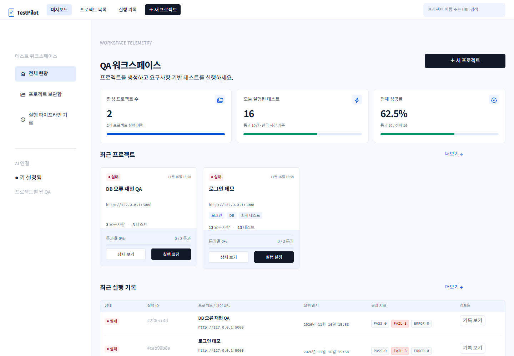
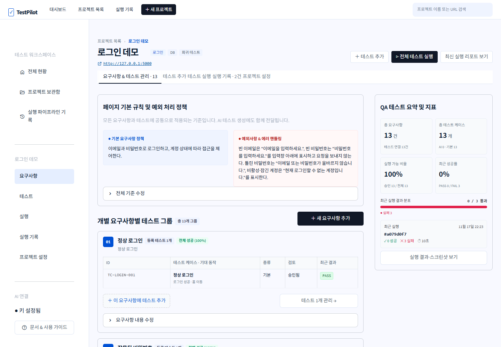
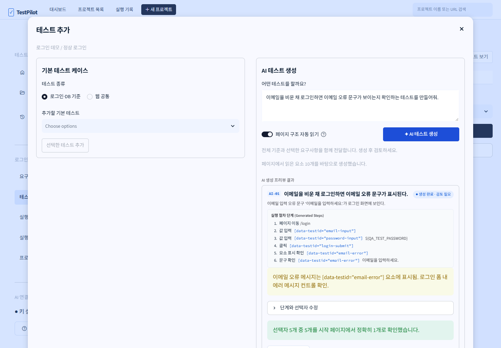
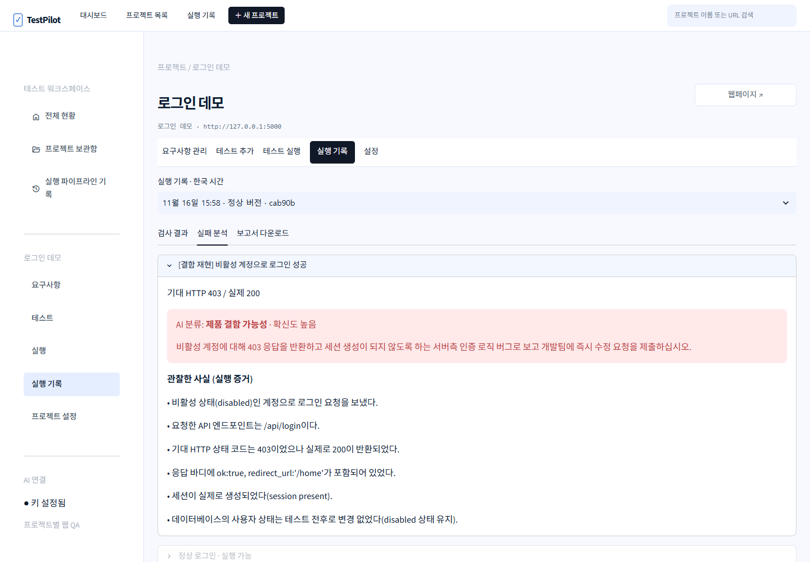

# AI 웹 QA 자동화 시스템 (TestPilot)

생성형 AI가 요구사항과 실제 페이지 구조를 바탕으로 브라우저 테스트를 설계하고, 사람이 검토한 테스트를 실제 브라우저에서 실행한 뒤, 실패하면 그 원인이 테스트 쪽인지 제품 쪽인지 구분해 QA 보고서로 정리하는 인공지능프로젝트 과목의 개인 프로젝트입니다.

- **Notion 프로젝트 계획서:** [AI 웹 QA 자동화 시스템](https://www.notion.so/3eb65ab291e7815faa49c0bb80c996df)
- **GitHub:** https://github.com/Rascal7/26AI_QAproject
- **일정:** 7주차 기획, 9~11주차 총 3주 구현 및 테스트
- **문서 범위:** 이 문서는 현재 구현된 시스템과 측정 결과를 설명합니다. 설치·실행 방법은 [README](README.md), 검증 기록은 [VALIDATION.md](VALIDATION.md), AI 효과 측정은 [AI 기능 효과 측정](docs/ai-evaluation.md)에 있습니다. 처음 기획과 달라진 점은 [기획서](AI_Web_QA_Project_Plan.md)의 "구현 반영 사항"에 정리했습니다.

## 1. 개발 배경과 목적

웹 기능이 추가되거나 수정될 때 정상 동작, 잘못된 입력, 경계값과 예외 상황을 반복해서 확인해야 합니다. 개인 개발자와 소규모 팀은 테스트 케이스 작성, 자동화 코드 구현, 실패 원인 조사와 보고서 작성에 많은 시간을 씁니다.

이 프로젝트는 생성형 AI의 테스트 설계·분석 능력과 실제 브라우저 자동화를 연결해 반복적인 QA 업무를 돕습니다. **AI 응답만으로 성공 여부를 판단하지 않습니다.** PASS/FAIL은 실제 브라우저 실행 결과로 정하고, AI가 낸 결과는 사람이 검토합니다.

## 2. 사용자와 핵심 기능

주요 사용자는 웹 개발자, QA 엔지니어, 소규모 개발팀, 개인 개발자 및 QA 자동화 학습자입니다.

| 기능 | 입력 → 처리 → 출력 |
|---|---|
| 프로젝트·요구사항 관리 | 웹페이지 URL, 전체 요구사항·예외사항, 개별 요구사항 → 저장·태그·검색 → 요구사항별 테스트 그룹 |
| AI 테스트 생성 | 요구사항 + 사용자 요청 + **실제 페이지 구조** → AI가 브라우저 동작 단계 설계 → 선택자를 실제 페이지에서 확인한 테스트 초안 |
| 테스트 검토·승인 | AI 초안·기본 템플릿 → 사람이 단계·선택자 수정 후 승인 → 실행 가능한 테스트 |
| 자동 실행 | 승인한 테스트 → pytest·Playwright·Chromium(별도 프로세스) → PASS/FAIL/ERROR와 스크린샷·trace 증거 |
| AI 실패 분석 | FAIL의 요구사항·단계·오류·HTTP·세션·DB 증거 → AI가 원인 분류 → 테스트 정의 문제 / 제품 결함 / 환경 문제, 관찰 사실과 추정 원인 |
| QA 보고서 | 실행 결과·AI 분석 → 프로그램 집계 → 마크다운 보고서·실행 기록·대시보드 |

로그인 데모 프로젝트에는 사람이 정한 기준 테스트 10개(로그인 5개, DB 비정상 상태 5개)와 의도적 결함 재현 테스트가 함께 들어 있습니다.

## 3. 구현 범위

- **로그인 데모:** Flask + SQLite. 정상·입력 오류·비활성·잠금·해시 손상·로그인 후 삭제·중복 이메일을 처리하고, 홈 화면에서 로그아웃할 수 있습니다.
- **DB 비정상 상황 테스트:** 테스트마다 새 SQLite DB와 브라우저를 만들고, 고정된 fixture로만 DB 상태를 바꿉니다. 기대한 401·403·503 응답은 PASS입니다.
- **결함 실험:** 비활성 검사 누락, 잠금 검사 누락, 삭제 사용자 재검증 누락, 손상 데이터 오분류 버전을 테스트 실행에서만 켭니다.
- **일반 웹 프로젝트:** 등록한 URL에 실제 브라우저로 접속해 이동·입력·클릭·키 입력과 HTTP·문구·요소·주소 확인을 실행합니다.
- **AI 기능:** 페이지 구조 기반 테스트 생성, 생성된 선택자 확인, 실패 원인 분석, 보고서 부록 작성.

범위 밖: 임의 Python·JavaScript·SQL 실행, 사이트 내부 DB 접근(로그인 데모 제외), 자동 코드 수정, CI/CD.

## 4. 시스템 구조와 기술

| 구성 | 기술 | 역할 |
|---|---|---|
| QA 관리 UI | Python, Streamlit | 프로젝트·요구사항·테스트·실행·기록 관리 |
| AI 모듈 | OpenAI API (Structured Outputs) | 테스트 단계 설계, 실패 원인 분류 |
| 페이지 구조 읽기 | Playwright (별도 프로세스) | 요소·선택자 추출, 생성된 선택자 확인 |
| 실행 제어 | 허용된 브라우저 동작 8종, 응답 스키마 검증, 사람 승인 | AI 출력이 코드로 실행되지 않게 제한 |
| 테스트 실행 | pytest, Playwright, Chromium (또는 Edge) | 브라우저 조작과 검증, 증거 수집 |
| 테스트 대상 | Flask 로그인 데모, SQLite / 등록한 웹페이지 | 정상·예외 동작 실험 |
| 데이터 저장 | SQLite, 실행별 파일 | 요구사항·테스트·이력·결과·분석·보고서 |
| 개발 관리 | Git, GitHub, Notion | 변경 이력, 문서, 계획 관리 |

```text
사용자 → 프로젝트·요구사항 입력
      → 페이지 구조 읽기 → OpenAI: 브라우저 동작 단계 설계 → 실제 페이지에서 선택자 확인
      → 사람 검토·수정·승인
      → pytest / Playwright (API 키 없는 별도 프로세스) → 대상 웹페이지
      → PASS / FAIL / ERROR + 증거 저장
      → FAIL이면 OpenAI: 원인 분류 (테스트 / 제품 / 환경)
      → QA 보고서
```

AI는 정해진 동작 8종(`navigate`, `fill`, `click`, `press`, `assert_status`, `assert_visible`, `assert_text`, `assert_url`)을 조합한 JSON만 만듭니다. 실행 엔진은 같은 사이트 밖으로 이동하지 못하게 막고, 비밀번호는 `${QA_TEST_PASSWORD}` 같은 환경변수 참조로만 입력하게 합니다.

## 5. UI/UX

로컬 앱의 실제 화면입니다. `python -m scripts.capture_ui_docs`로 다시 찍을 수 있습니다.

### 대시보드


### 요구사항 관리


### AI 테스트 생성 — 페이지 구조 전달과 선택자 확인


### 실패 분석 — AI 원인 분류


## 6. AI 활용방안

1. **테스트 설계:** 요구사항, 예외사항, 사용자 요청과 함께 **대상 페이지와 이동 후 페이지에서 읽은 요소·선택자 목록**을 AI에 전달합니다. 이동 후 페이지는 링크와 요구사항에 적힌 같은 사이트 경로를 조회만 해서 읽고, 로그아웃·삭제 같은 링크는 열지 않습니다. AI는 정상·예외 시나리오를 브라우저 동작 단계로 설계하고, 추정한 부분은 검토 메모에 적습니다.
2. **선택자 확인:** 생성된 선택자가 실제 페이지에서 정확히 1개 요소와 일치하는지 프로그램이 확인해 보여줍니다. 사람은 이 결과를 보고 단계를 수정·승인합니다.
3. **실패 분석:** FAIL마다 요구사항과 실행 증거를 보내, 실행 증거에서 확인한 **관찰 사실**과 AI의 **추정 원인**을 나누고, 원인이 **테스트 정의 문제 / 제품 결함 / 환경 문제** 중 어디에 가까운지 분류합니다. 테스트 문제면 고칠 단계를, 제품 결함이면 버그 리포트 요약을 제안합니다.
4. **보고서 보조:** AI 분석을 실행 보고서에 부록으로 덧붙입니다. 통계와 PASS/FAIL 판정은 프로그램이 계산합니다.

AI가 기대 결과를 바꾸거나 PASS/FAIL을 정하지는 않습니다. Codex와 Claude Code는 개발 과정의 코드 작성·수정·리뷰를 돕는 도구로 사용했습니다.

## 7. 일정 계획

수업 주차 기준 계획입니다. 8주차는 개발 일정에서 제외했고, 실제 진행 결과는 [VALIDATION.md](VALIDATION.md)에 날짜별로 기록했습니다.

| 주차 | 목표 | 구체적인 작업 | 완료 기준 |
|---|---|---|---|
| 7주차 · 기획 | 설계 확정 | 요구사항·핵심 기능·구조·UI/UX·AI 입출력 설계, 테스트 기준, GitHub·README 정리 | 계획서 및 3주 구현 일정 |
| 9주차 · 구현·단위 테스트 | 케이스 생성까지 | 로그인 데모·DB·UI, AI 연결·테스트 생성·검토, 입력 검증과 정상·예외 테스트 | 데모·입력·생성·검토 동작, 기준 TC 10개 |
| 10주차 · 구현·통합 테스트 | 자동 실행과 결과 | 실행 제한·승인, 브라우저 실행·저장, 결과 분류·증거·데이터 격리 테스트 | 입력부터 실행 결과까지 연결 |
| 11주차 · 구현 마무리·최종 테스트 | 분석·보고서·완성 | AI 분석·보고서, 결함 비교·효과 측정·오류 수정, README·최종 보고서·발표 준비 | 최종 결과물 및 발표 준비 완료 |

## 8. 테스트 및 평가 결과

**기능 검증**
- 자동 테스트 69개가 모두 통과했습니다. GitHub Actions가 푸시할 때마다 같은 테스트를 실행합니다. 서버 계약, DB 시나리오, 프로젝트 격리, 화면 동작, 실행 제한, 민감정보 제거, AI 기능이 포함됩니다.
- 정상 버전에서는 기준 10개가 모두 PASS했습니다. 테스트 순서를 뒤집어도 같은 결과가 나와 테스트끼리 서로 영향을 주지 않는다는 것을 확인했습니다.

**결함 탐지**
- 주입한 결함 3개를 모두 찾아냈습니다(3/3).
- 정상적인 예외 처리를 버그로 잘못 보고한 경우는 0건입니다.

**AI 효과** ([상세](docs/ai-evaluation.md))
| 측정 | 결과 |
|---|---|
| AI 테스트를 수정 없이 실행했을 때 PASS — 구조 없음 → 시작 페이지 구조 → 시작+이동 후 페이지 구조 | 43% → 93% → **100%** (각 30개) |
| 생성된 선택자가 읽은 페이지에서 정확히 일치 | 59.7% → 98.8% → **98.8%** |
| `data-testid`가 없는 페이지의 PASS | 0/15 → 13/15 → **15/15** |
| 실패 원인 분석: AI가 만든 테스트가 틀린 경우를 테스트 문제로 분류 | **7/7**, 이전 측정 9/9 |
| 실패 원인 분석: 실제 제품 결함을 제품 결함으로 분류 (결함 표시를 가림) | **18/18** |

**지표 정의**
- 성공률 = PASS / (PASS + FAIL) × 100입니다.
- ERROR와 미실행 항목은 성공률 계산에서 빼고 따로 표시합니다.
- 보고서의 실행 완료율은 PASS·FAIL 판정까지 끝난 테스트의 비율입니다.

**남은 평가**
- 유효 TC 비율: 생성된 테스트가 요구사항에 맞는 의미 있는 검사인지 사람이 판정해야 합니다. 판정 결과는 [CSV](experiments/results/ai-quality-20261117-2130.csv)에 기록합니다.
- 작업 시간: 테스트를 직접 작성할 때 걸리는 시간과의 비교는 아직 측정하지 않았습니다.

**확인된 한계**
- 이동 후 페이지는 조회만으로 읽습니다. 로그인이 필요한 페이지처럼 직접 볼 수 없는 페이지의 요소는 여전히 요구사항 문장과 AI의 짐작에 의존합니다.
- 측정 표본이 작습니다(페이지 2개, 시나리오 10개).

## 9. 실행·데이터 관리 원칙

- AI 출력은 정해진 브라우저 동작 형식만 허용하고, 사람이 검토·승인한 뒤 실행합니다. 임의 코드는 실행하지 않습니다.
- 테스트 실행과 페이지 읽기는 API 키가 없는 별도 프로세스에서 합니다.
- API 키는 환경변수(`.env`)로 관리하며 GitHub에 올리지 않습니다.
- 실행 DB, 개인 로그, 실행 증거와 가상환경은 공개 소스에서 제외합니다.
- 실제 비밀번호·세션 정보·입력값·로컬 파일 경로는 AI 입력과 공개 보고서에서 제외합니다.
- 테스트 결과는 PASS, FAIL, ERROR로 구분해 제품 결함과 실행 환경 오류를 분리합니다.

## 10. 최종 결과물

- 실행 가능한 QA 시스템과 로그인 데모
- 소스 코드와 설치·실행 안내
- 기준 테스트와 실행 증거
- 버그·QA 보고서
- AI 효과 측정 자료와 다시 측정할 수 있는 실험 스크립트(`experiments/`)
- 발표 슬라이드와 시연 자료

Notion에는 기획·설계·일정을, GitHub에는 프로젝트 설명·소스 코드·변경 이력을 관리합니다.
