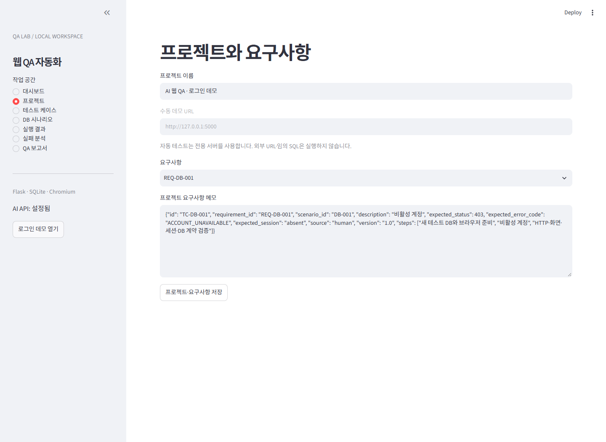
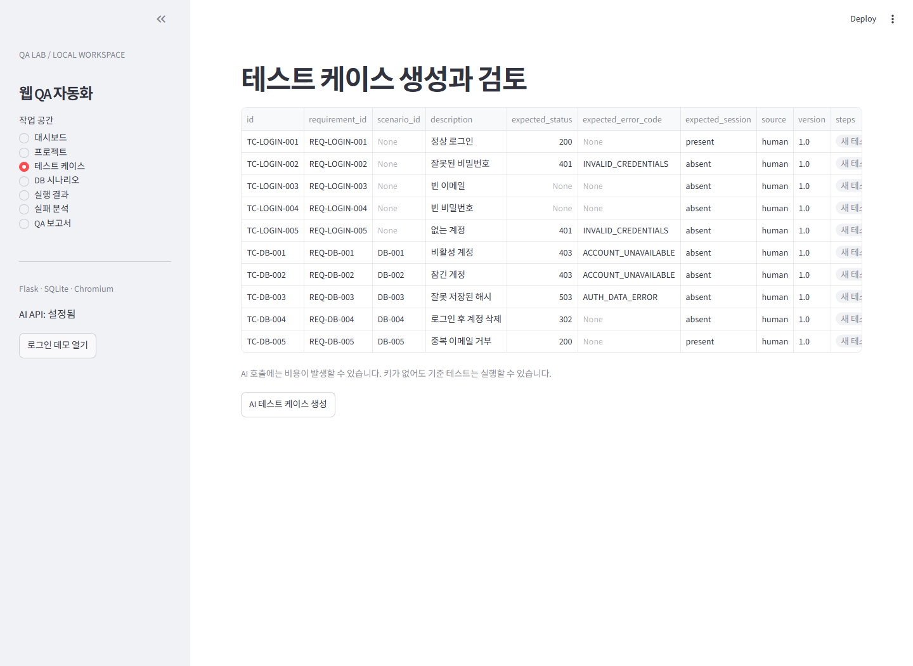
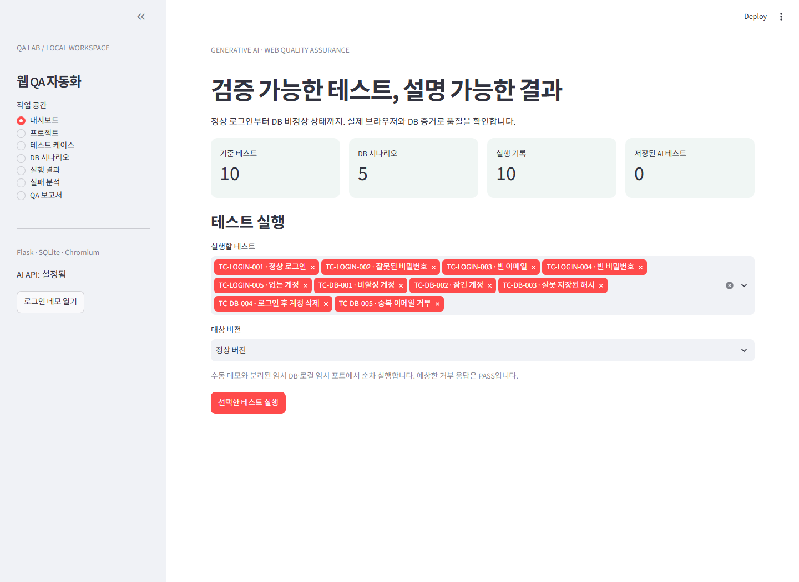

# AI 웹 QA 자동화 시스템

생성형 AI를 활용해 웹 기능의 요구사항을 테스트 케이스로 구체화하고, 검토한 테스트를 실제 브라우저에서 실행한 뒤 실패 원인과 QA 결과를 정리하는 인공지능프로젝트 과목의 개인 프로젝트입니다.

- **Notion 프로젝트 계획서:** [AI 웹 QA 자동화 시스템](https://www.notion.so/3eb65ab291e7815faa49c0bb80c996df)
- **GitHub:** https://github.com/Rascal7/26AI_QAproject
- **일정:** 7주차 기획, 9~11주차 총 3주 구현 및 테스트
- **이 README의 범위:** 프로젝트 개요와 설계·개발 계획입니다. 아래 항목은 계획과 완료 기준을 설명하며, 구현 완료 또는 성능 검증 결과를 의미하지 않습니다.

## 1. 개발 배경과 목적

웹 기능이 추가되거나 수정될 때 정상 동작, 잘못된 입력, 경계값과 예외 상황을 반복적으로 확인해야 합니다. 개인 개발자와 소규모 팀은 테스트 케이스 작성, 자동화 코드 구현, 실패 원인 조사와 보고서 작성에 많은 시간을 씁니다.

이 프로젝트는 생성형 AI의 테스트 설계·분석 능력과 실제 브라우저 자동화를 연결해 반복적인 QA 업무를 보조합니다. AI 응답만으로 성공 여부를 판단하지 않고 실행 결과와 증거를 확인합니다.

## 2. 사용자와 핵심 기능

주요 사용자는 웹 개발자, QA 엔지니어, 소규모 개발팀, 개인 개발자 및 QA 자동화 학습자입니다.

| 기능 | 입력 → 처리 → 출력 |
|---|---|
| 요구사항 관리 | 프로젝트·기능 명세 → 입력 검증·저장 → 검토 가능한 요구사항 |
| AI 테스트 케이스 생성 | 명세·테스트 계약 → 정상·경계값·예외 시나리오 설계 → 구조화된 TC |
| 테스트 검토·코드 생성 | 선택한 TC → 사용자 검토·AI 코드 생성 → Python 테스트 코드 |
| 자동 실행 | 검토·승인한 코드 → pytest·Playwright·Chromium → 실행 결과와 증거 |
| 실패 분석 | 코드·로그·기대/실제 결과 → AI 분석 → 관찰 사실·원인 후보·추가 확인 사항 |
| QA 보고서 | 결과·분석 → 집계 및 요약 → 테스트 현황·버그 리포트 |

TC에는 식별자, 설명, 사전 조건, 수행 단계와 기대 결과를 포함합니다. 버그 리포트에는 제목, 재현 절차, 기대 결과, 실제 결과, 심각도 및 추정 원인을 정리합니다.

## 3. MVP 범위

3주 구현 기간에는 **로컬 로그인 데모를 대상으로 한 QA 전체 흐름**을 우선 완성합니다.

- 로그인 정상·입력 오류·계정 상태 등을 확인하는 기준 테스트 10개
- 요구사항 입력과 AI 케이스 생성·검토
- 허용된 템플릿의 Python 테스트 코드 생성과 실행 승인
- 브라우저 자동 실행 및 결과·로그·스크린샷 저장
- AI 실패 분석, 기본 버그 리포트와 QA 대시보드

회원가입·게시글 기능, 임의 웹사이트 지원, 자동 코드 수정, API 테스트 및 CI/CD는 확장 후보입니다. 초기 버전은 사전 정의된 테스트 계약을 기준으로 하며 임의 코드를 실행하는 범용 시스템을 목표로 하지 않습니다.

## 4. 시스템 구조와 기술

| 구성 | 기술 | 역할 |
|---|---|---|
| QA 관리 UI | Python, Streamlit | 입력·검토·실행·결과 조회 |
| AI 모듈 | OpenAI API | 케이스 제안, 코드 생성, 실패 분석 |
| 검토·실행 제어 | 응답 스키마 검증, AST 검사, 사용자 승인 | 실행 가능한 코드 제한 |
| 테스트 실행 | pytest, Playwright, Chromium | 브라우저 조작과 검증 |
| 테스트 대상 | Flask 로그인 데모, SQLite | 정상·예외 동작 실험 |
| 데이터 저장 | SQLite, 실행별 파일 | 요구사항·TC·이력·보고서·증거 |
| 개발 관리 | Git, GitHub, Notion | 변경 이력, 문서, 계획 관리 |

```text
사용자 → Streamlit 요구사항 입력 → OpenAI API 테스트 설계
      → 사용자 케이스 검토 → 코드 생성·검증·실행 승인
      → pytest / Playwright / Chromium → Flask 로그인 데모
      → 실행 결과·증거 저장 → AI 실패 분석 → QA 보고서
```

프로젝트 → 요구사항 → 테스트 케이스 → 실행 이력 → 개별 결과 → 보고서를 연결합니다. 자동 테스트는 테스트별 DB와 브라우저 컨텍스트를 분리해 데이터 간섭을 줄입니다.

## 5. UI/UX 예시

로컬 앱의 실제 화면입니다. 요구사항 입력 → 테스트 검토 → 실행 순서로 사용합니다.

### 요구사항 입력


### 테스트 케이스 검토


### 테스트 실행 대시보드


## 6. AI 활용방안

1. **테스트 설계:** 요구사항과 테스트 계약을 입력받아 정상·경계값·예외 케이스를 구조화된 형식으로 제안합니다.
2. **코드 생성:** 검토된 TC를 허용된 Python 테스트 템플릿으로 변환합니다.
3. **실패 분석:** 실제 결과와 민감정보를 제거한 로그로 관찰 사실과 원인 후보를 구분합니다.
4. **보고서 보조:** 검증된 증거를 바탕으로 버그 설명과 QA 요약 초안을 작성합니다.

실제 브라우저 제어와 PASS/FAIL 판정은 Playwright 테스트가 담당합니다. 통계는 프로그램이 계산하고, AI의 추정 원인·심각도는 사용자가 검토합니다. Codex는 개발 과정의 코드 작성·수정·리뷰를 지원하는 도구로 활용합니다.

## 7. 구체적인 일정 계획

수업 주차 기준입니다. 8주차는 개발 일정에서 제외하며 실제 발표일은 수업 공지에 따릅니다.

| 주차 | 목표 | 구체적인 작업 | 완료 기준 |
|---|---|---|---|
| 7주차 · 기획 | 설계 확정 | 요구사항·핵심 기능·구조·UI/UX·AI 입출력 설계, 테스트 기준, GitHub·README 정리 | 계획서 및 3주 구현 일정 |
| 9주차 · 구현·단위 테스트 | 케이스 생성까지 | 전반: 로그인 데모·DB·UI / 중반: AI 연결·TC 생성·검토 / 후반: 입력 검증과 정상·예외 테스트 | 데모·입력·생성·검토 동작, 기준 TC 10개 |
| 10주차 · 구현·통합 테스트 | 자동 실행과 결과 | 전반: 코드 생성·검증·승인 / 중반: 브라우저 실행·저장 / 후반: 결과 분류·증거·데이터 격리 테스트 | 입력부터 실행 결과까지 연결 |
| 11주차 · 구현 마무리·최종 테스트 | 분석·보고서·완성 | 전반: AI 분석·보고서 / 중반: 결함 비교·평가·오류 수정 / 후반: README·최종 보고서·슬라이드·시연 준비 | 주차 말 최종 결과물 및 발표 준비 완료 |

일정이 지연되면 대상 기능 확장과 상세 시각화를 후순위로 두고 로그인 QA 핵심 흐름, 검증, 문서화를 우선합니다.

## 8. 테스트 및 평가

- **기능:** 요구사항 입력부터 보고서 조회까지 통합 흐름과 오류 처리 확인
- **TC 품질:** 동일 명세의 수동 TC와 AI TC를 비교해 유효·중복·오류 항목 집계
- **결함 탐지:** 정상 버전과 알려진 결함을 넣은 버전 비교
- **보고서 품질:** 재현 절차, 기대/실제 결과 및 원인 설명을 증거와 비교
- **작업 시간:** AI 생성뿐 아니라 사용자 검토·수정 시간을 포함해 수동 작업과 비교

유효 TC 비율 = 유효 TC 수 / 생성 TC 수 × 100.
성공률 = PASS / (PASS + FAIL) × 100이며 ERROR·미실행 항목은 별도 표시합니다. 분모가 0이면 성공률을 산출하지 않습니다. 실제 측정 전에는 수치를 성능 결과로 제시하지 않습니다.

## 9. 실행·데이터 관리 원칙

- AI 생성 코드는 형식 검사와 사용자 검토·승인 후 실행합니다.
- API 키는 환경변수로 관리하며 GitHub에 올리지 않습니다.
- 실행 DB, 개인 로그, 생성 결과와 가상환경은 공개 소스에서 제외합니다.
- 실제 비밀번호·세션 정보는 AI 입력과 공개 보고서에서 제외합니다.
- 테스트 결과는 PASS, FAIL, ERROR로 구분하고 제품 결함과 실행 환경 오류를 분리합니다.

## 10. 최종 결과물

실행 가능한 QA 시스템과 로그인 데모, 소스 코드와 설치·실행 안내, 테스트 케이스와 결과 증거, 버그·QA 보고서, 성능 평가 자료, 발표 슬라이드와 시연 자료를 준비합니다.

Notion에는 기획·설계·일정을, GitHub에는 프로젝트 설명과 코드 변경 이력을 관리합니다. 이 문서 갱신에서는 README를 반영하며, 로컬 소스 코드 전체 업로드는 포함하지 않습니다.

